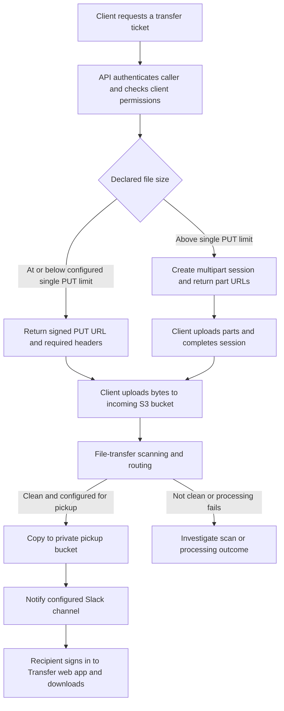
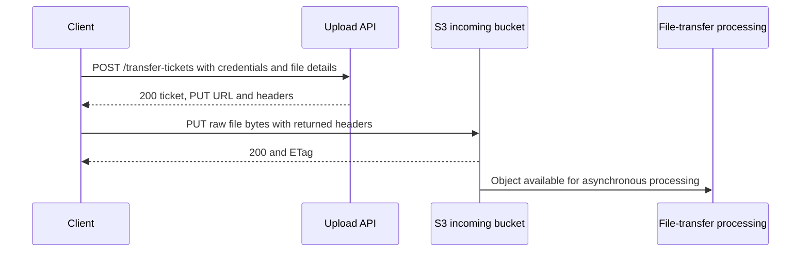
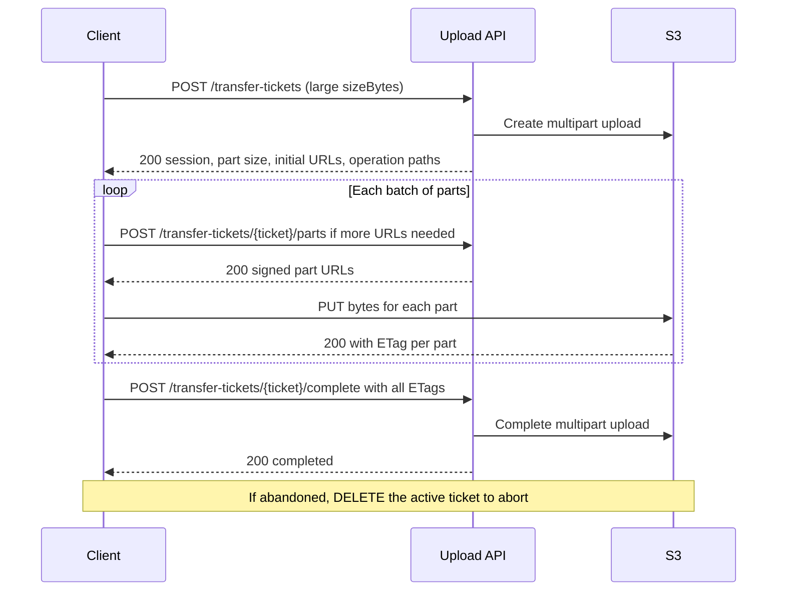
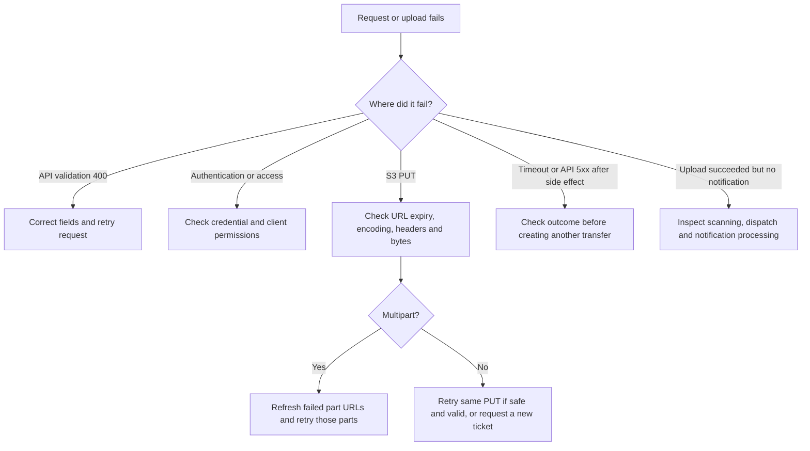

# File Transfer API: consumer and support guide

This guide explains how to upload a file, handle failures, and confirm that it is ready for collection. Managed File Transfer (MFT) separates upload authorisation from file transfer: the API gives you temporary permission to upload, and your client sends the bytes directly to Amazon S3.

## Contents

- [Documentation and access](#documentation-and-access)
- [End-to-end flow](#end-to-end-flow)
- [Authentication and permissions](#authentication-and-permissions)
- [Create a transfer ticket](#create-a-transfer-ticket)
- [Upload a single file](#upload-a-single-file)
- [Upload a large file in parts](#upload-a-large-file-in-parts)
- [HTTP responses and errors](#http-responses-and-errors)
- [Bad requests and upload failures](#bad-requests-and-upload-failures)
- [Confirm processing and collection](#confirm-processing-and-collection)
- [Support and implementation references](#support-and-implementation-references)

## Documentation and access

| Resource | Link |
| --- | --- |
| Development API base URL | `https://5yc80qz674.execute-api.eu-west-2.amazonaws.com` |
| Development Swagger UI | [Interactive API documentation](https://5yc80qz674.execute-api.eu-west-2.amazonaws.com/docs) |
| Development OpenAPI download | [openapi.yaml](https://5yc80qz674.execute-api.eu-west-2.amazonaws.com/openapi.yaml) |
| Version-controlled contract | [Repository OpenAPI definition](../openapi.yaml) |
| Deployment and credential administration | [Repository README](../README.md) |

Swagger and the hosted OpenAPI document require **dedicated documentation Basic-auth credentials**. Ask the service owner for access through an approved credential-sharing route. These can differ from upload credentials. Inside Swagger, use **Authorize** with your API credentials to call upload operations.

The development address is environment-specific. Use the infrastructure output `transfer_ticket_api_endpoint` for another deployment. The deployed Swagger contract is bundled with the application release, so unmerged repository changes may not appear there yet.

## End-to-end flow



The upload API owns tickets and multipart sessions. Scanning, routing, pickup storage, Slack delivery and download permissions belong to the downstream file-transfer infrastructure. They run asynchronously after upload.

A ticket response is **not** upload confirmation. An S3 upload response is **not** confirmation that scanning passed. A Slack notification depends on the client's downstream dispatch configuration.

## Authentication and permissions

All four upload API operations accept either:

```http
Authorization: Basic <base64(username:password)>
```

or:

```http
Authorization: Bearer <tokenId>.<bearerToken>
```

The bearer credential is an opaque Secrets Manager-managed token pair; this API does not issue OAuth2 access tokens. The authorizer looks up the principal and role, and the handler checks the role's allowed `clientId` values. A valid login does not grant access to every client.

Multipart follow-up access is checked against the session's client ID. It is not restricted to the original principal if another authorised principal can access that same client.

For S3 PUT requests, select **No Auth** in your HTTP client. The returned URL carries the signature. Do not send API Basic/Bearer credentials to S3, modify its query string, or double-encode it. Treat signed URLs as temporary credentials and avoid including them in tickets, screenshots or logs shared with others.

## Create a transfer ticket

### Request

`POST /transfer-tickets`, with `Content-Type: application/json` and API authentication.

```json
{
  "clientId": "products-poc",
  "fileName": "sample.txt",
  "contentType": "text/plain",
  "sizeBytes": 6,
  "requestedExpirySeconds": 900
}
```

| Field | Required | Meaning and validation |
| --- | --- | --- |
| `clientId` | Yes | Configured, enabled client that your role may access. |
| `fileName` | Yes | Original filename. Storage uses a generated UUID with a normalised extension; original basename is retained as metadata. |
| `sizeBytes` | Yes | Actual byte count, including newlines. Use a JSON integer, zero or greater, within the client's configured maximum. Controls single versus multipart selection. |
| `contentType` | Conditional | Must match the client's allow-list if configured; required when that list is non-empty. |
| `requestedExpirySeconds` | No | Defaults to deployment configuration; clamped to at least 1 second and at most its configured maximum. |
| `contentMd5` | No | Base64-encoded MD5 for single PUT only, passed as `Content-MD5`. Rejected for multipart. |

Do not assume every client has the same maximum file size or content types. Limits and initial part count are configured in infrastructure. Use the response's selected upload mode, part size and expiry rather than hard-coding them.

### Single-upload response: HTTP 200

Illustrative values below are placeholders, not working signed URLs.

```json
{
  "transferTicket": "5c43217f-aded-42b3-ac8e-b73f1b0cf600",
  "clientId": "products-poc",
  "upload": {
    "method": "PUT",
    "url": "https://incoming-bucket.s3.eu-west-2.amazonaws.com/object-key?SIGNED_QUERY",
    "headers": {
      "x-amz-server-side-encryption": "aws:kms",
      "x-amz-server-side-encryption-aws-kms-key-id": "arn:aws:kms:eu-west-2:123456789012:key/example",
      "x-amz-meta-client-id": "products-poc",
      "x-amz-meta-declared-size-bytes": "6",
      "x-amz-meta-original-file-name": "sample.txt",
      "x-amz-meta-transfer-ticket": "5c43217f-aded-42b3-ac8e-b73f1b0cf600",
      "Content-Type": "text/plain"
    },
    "expiresInSeconds": 900
  },
  "object": {
    "bucket": "incoming-bucket",
    "key": "products-poc/uploads/2026/10/15/generated-id.txt"
  }
}
```

If supplied, `Content-MD5` is also returned in `upload.headers`. Copy **all** returned headers. The KMS headers tell S3 to encrypt the object using the specified AWS Key Management Service key; the ARN identifies the key, not its secret material. The metadata associates the object with the client and ticket.

The URL's `X-Amz-*` parameters carry AWS signing information, including the credential scope, timestamp, expiry, signed headers, temporary session token and signature. Preserve the entire URL exactly. Temporary AWS credentials can expire before the requested URL duration.

## Upload a single file



### Working command-line example

Requires `curl` and Python 3. The first command creates a six-byte file. Curl prompts for your password; do not put it in the script.

```bash
printf 'Hello\n' > /tmp/sample.txt
curl --fail-with-body --user 'products-poc-user' \
  --header 'Content-Type: application/json' \
  --data '{"clientId":"products-poc","fileName":"sample.txt","contentType":"text/plain","sizeBytes":6,"requestedExpirySeconds":900}' \
  'https://5yc80qz674.execute-api.eu-west-2.amazonaws.com/transfer-tickets' \
  --output /tmp/upload-ticket.json
```

Only after that request succeeds, upload using the returned URL and headers:

```bash
python3 - <<'PY'
import json
import urllib.request
from pathlib import Path

ticket = json.loads(Path('/tmp/upload-ticket.json').read_text())
upload = ticket['upload']
request = urllib.request.Request(
    upload['url'],
    data=Path('/tmp/sample.txt').read_bytes(),
    headers=upload['headers'],
    method=upload['method'],
)
with urllib.request.urlopen(request, timeout=60) as response:
    print('Upload HTTP status:', response.status)
    print('ETag:', response.headers.get('ETag'))
PY
```

This small-file example reads the file into memory. Use streaming or multipart tooling for large files. S3 normally returns **200 with an empty body and an `ETag` header**. There is no single-upload completion call to the API.

### Bruno configuration

In the ticket request's post-response script:

```javascript
const ticket = res.getBody();
if (!ticket.upload?.url) throw new Error('No single-upload URL returned');
bru.setVar('mftUploadUrl', ticket.upload.url);
bru.setVar('mftUpload', JSON.stringify(ticket.upload));
```

Create the second request with method **PUT**, URL **`{{mftUploadUrl}}`**, **No Auth**, and **File/Binary** body selecting the same file described in the ticket. Disable **URL Encoding** in that request's settings so the already encoded signature is preserved. Keep TLS certificate verification enabled.

Use this pre-request script on the PUT:

```javascript
const saved = bru.getVar('mftUpload');
if (!saved) throw new Error('Run the ticket request successfully first');
const upload = JSON.parse(saved);
req.setUrl(upload.url);
req.setMethod(upload.method);
req.deleteHeader('Authorization');
for (const [name, value] of Object.entries(upload.headers || {})) {
  req.setHeader(name, String(value));
}
```

Do not prefix the variable with another `https://`. Do not use a JSON or multipart/form-data body. Run the first request again whenever you need a fresh URL, and do not reuse a stale variable after a failed ticket request.

## Upload a large file in parts

The same ticket request automatically selects multipart when declared size exceeds `SINGLE_PUT_LIMIT_BYTES`. No separate create endpoint or mode field is needed.



### Multipart ticket response: HTTP 200

Example: a 6 GiB file with a returned 64 MiB part size has 96 parts. Actual settings may differ. The example shows one initial URL; the server may return more.

```json
{
  "transferTicket": "5c43217f-aded-42b3-ac8e-b73f1b0cf600",
  "clientId": "products-poc",
  "object": {"bucket": "incoming-bucket", "key": "products-poc/uploads/2026/10/15/generated-id.bin"},
  "multipart": {
    "uploadId": "example-s3-upload-id",
    "partSizeBytes": 67108864,
    "totalParts": 96,
    "maxParts": 10000,
    "expiresInSeconds": 900,
    "initialParts": [
      {"partNumber": 1, "method": "PUT", "url": "https://incoming-bucket.s3.eu-west-2.amazonaws.com/object-key?SIGNED_PART_QUERY", "headers": {}, "expiresInSeconds": 900}
    ],
    "operations": {
      "presignPartsPath": "/transfer-tickets/5c43217f-aded-42b3-ac8e-b73f1b0cf600/parts",
      "completePath": "/transfer-tickets/5c43217f-aded-42b3-ac8e-b73f1b0cf600/complete",
      "abortPath": "/transfer-tickets/5c43217f-aded-42b3-ac8e-b73f1b0cf600"
    }
  }
}
```

Split the file using `partSizeBytes`; only the last part may be smaller. Upload each part as raw binary to its own URL and retain the exact returned `ETag`, including quotes. An ETag is not necessarily a whole-file MD5, particularly for multipart or KMS-encrypted objects.

### Request or refresh part URLs

`POST /transfer-tickets/{transferTicket}/parts`, authenticated, JSON body:

```json
{"partNumbers": [1, 2, 3]}
```

Alternatively, use an inclusive range; do not combine the two forms:

```json
{"partNumberStart": 4, "partNumberEnd": 10}
```

HTTP 200 response:

```json
{
  "transferTicket": "5c43217f-aded-42b3-ac8e-b73f1b0cf600",
  "clientId": "products-poc",
  "uploadId": "example-s3-upload-id",
  "parts": [
    {"partNumber": 1, "method": "PUT", "url": "https://incoming-bucket.s3.eu-west-2.amazonaws.com/object-key?SIGNED_PART_QUERY", "headers": {}, "expiresInSeconds": 900},
    {"partNumber": 2, "method": "PUT", "url": "https://incoming-bucket.s3.eu-west-2.amazonaws.com/object-key?SIGNED_PART_QUERY", "headers": {}, "expiresInSeconds": 900},
    {"partNumber": 3, "method": "PUT", "url": "https://incoming-bucket.s3.eu-west-2.amazonaws.com/object-key?SIGNED_PART_QUERY", "headers": {}, "expiresInSeconds": 900}
  ]
}
```

Part numbers are deduplicated and sorted for URL generation. They must be within both the configured part limit and the session's `totalParts`. Request new URLs for failed or expired parts while the session is active. Session expiry is seven days from creation and is distinct from individual URL expiry.

### Upload each part to S3

Use each part's `method`, `url` and `headers`, with no API authentication. S3 returns **HTTP 200**, an `ETag` header, and normally no response body. Store the mapping from part number to ETag. Retrying the same part number replaces that part; use its most recent ETag.

### Complete the upload

`POST /transfer-tickets/{transferTicket}/complete`, authenticated, JSON body containing **every successfully uploaded part**:

```json
{
  "parts": [
    {"partNumber": 1, "eTag": "\"example-etag-1\""},
    {"partNumber": 2, "eTag": "\"example-etag-2\""}
  ]
}
```

This illustrates a two-part completion; the 96-part example requires all 96 entries. The handler sorts parts and rejects duplicate or out-of-range numbers. S3 validates the supplied parts and ETags.

HTTP 200 response:

```json
{
  "transferTicket": "5c43217f-aded-42b3-ac8e-b73f1b0cf600",
  "clientId": "products-poc",
  "status": "completed",
  "object": {"bucket": "incoming-bucket", "key": "products-poc/uploads/2026/10/15/generated-id.bin"},
  "result": {"eTag": "\"example-completed-etag\"", "location": "https://incoming-bucket.s3.eu-west-2.amazonaws.com/object-key", "partCount": 2}
}
```

`result.location` identifies the object; it is not a public or presigned download link. Completion makes the object available for downstream processing, not immediately approved for pickup.

### Abort an abandoned upload

`DELETE /transfer-tickets/{transferTicket}`, authenticated, no request body.

HTTP 200 response:

```json
{
  "transferTicket": "5c43217f-aded-42b3-ac8e-b73f1b0cf600",
  "clientId": "products-poc",
  "status": "aborted"
}
```

Abort applies to an active multipart session. It is not a delete-file endpoint for completed or single uploads. Subsequent operations on an aborted or completed session return 409 while the record exists.

## HTTP responses and errors

### Upload API

| HTTP code | Source and meaning | What to do |
| --- | --- | --- |
| `200` | Ticket/part URLs created, multipart completed, or multipart aborted. | Inspect the body; ticket creation alone has not transferred any bytes. |
| `400` | Handler rejected the request: invalid JSON/object shape, missing fields, disallowed content type, excessive declared size, invalid part selection/completion payload, or multipart `contentMd5`. | Correct the request; do not retry unchanged. |
| `401` | API Gateway may reject a missing required authentication identity. | Supply API authentication. |
| `403` | Authorizer denies credentials, or handler denies client access/disabled client. | Check credentials, enabled principal/client and role mapping. |
| `404` | Unknown authorised client, missing multipart ticket, or unsupported route. | Verify endpoint and IDs; a single-upload ticket is not a multipart session. |
| `409` | Multipart session expired or is no longer `initiated`. | Do not continue that session; investigate completion or start a new transfer as appropriate. |
| `429` | Gateway throttling. | Back off with jitter and bounded retries; ask the service owner if sustained. |
| `5xx` | Gateway, authorizer, integration or unhandled dependency failure. | Capture request IDs and investigate before retrying operations with side effects. |

Create returns application-level 200/400/403/404. Parts, completion and abort additionally use 409 for session state; abort can return 400 for a missing path parameter in handler invocation. Authentication, throttling and integration errors can affect every operation. Gateway-generated bodies need not match the handler's JSON errors.

Typical handler error:

```json
{"message": "sizeBytes is required"}
```

An error may include supporting fields:

```json
{"message": "contentType is not allowed for this client", "allowedContentTypes": ["text/plain"]}
```

```json
{"message": "Transfer ticket 'example-ticket' is not active", "status": "completed"}
```

Handler responses use `application/json` and `Cache-Control: no-store`. There is no universal application error code or correlation field in these bodies; retain the gateway request ID from the response headers.

### Direct S3 uploads

These requests bypass the upload API. S3 errors are normally XML, for example:

```xml
<Error>
  <Code>SignatureDoesNotMatch</Code>
  <Message>The request signature we calculated does not match the signature you provided.</Message>
  <RequestId>example-request-id</RequestId>
</Error>
```

| Typical HTTP code / S3 error | Meaning and recovery |
| --- | --- |
| `200` | PUT or part upload accepted. Save the ETag. |
| `400` / `AuthorizationQueryParametersError` | Signed query malformed, often after URL re-encoding. Preserve the returned URL exactly. |
| `400` / `BadDigest` | `Content-MD5` does not match the bytes sent. Recalculate against the actual file. |
| `403` / `SignatureDoesNotMatch` | Method, URL or signed headers differ from the ticket. Copy them exactly. |
| `403` / `AccessDenied` or expired credentials | URL expiry or S3/KMS policy/credential problem. Obtain a fresh URL; escalate if a fresh one also fails. |
| `404` / `NoSuchUpload` | Multipart upload no longer exists. Check whether it was completed or aborted. |
| `5xx`, including `503 SlowDown` | Temporary S3/service problem. Use bounded retries with backoff. |

S3 status and error details vary; use the XML `Code` and request ID as well as HTTP status. Errors raised by S3 during API-driven completion/abort are currently logged and re-raised by the Lambda, rather than translated into the S3 HTTP codes above. Clients may therefore receive a gateway 5xx for those failures.

### Documentation routes

| Request | Success | Other responses |
| --- | --- | --- |
| `GET /docs` or `/docs/` | 200 HTML Swagger page | 401 text `Authentication required`, with a Basic-auth challenge. |
| `GET /openapi.yaml` | 200 YAML | 401 as above; 500 text `OpenAPI document not available` if the bundled file is missing. |

The docs handler returns 404 text `Not found` for other paths routed to it. Gateway failures can also occur.

## Bad requests and upload failures



### What the API validates

The handler checks client permission/configuration, required fields, configured content types, declared size, requested expiry conversion, and multipart request structure/session state. Recognised validation failures return 400 without proceeding with the requested upload action.

This is not comprehensive schema enforcement. For example, integer fields are converted with Python `int()`, and some unexpected field types can cause an unhandled exception rather than a helpful 400. Send the types described by OpenAPI even if a loosely typed value appears to work.

### What is not guaranteed

- `sizeBytes` is declared metadata used for selection and limit checks. The single PUT signature does not bind an exact content length. The API does not compare final object size against the declaration.
- Completion validates supplied part entries but does not independently enforce that all expected part numbers or the declared byte total were supplied. Clients must send the complete file correctly.
- There is no idempotency key. Repeating ticket creation makes a new object key and potentially a new multipart upload.
- Completion and abort are not idempotent API operations: a recorded completed/aborted session returns 409 on retry.
- S3 and DynamoDB changes are not a transaction. For example, S3 completion may succeed before the session update fails. A timeout or 5xx can leave an ambiguous outcome.
- Session TTL expiry does not itself abort an S3 multipart upload. Abandoned-upload cleanup depends on bucket lifecycle/operational configuration; do not assume deleting a session record cleans up parts.

### Recovery procedure

1. For a ticket validation failure, correct the payload and create a ticket again. No file bytes have been uploaded by this call.
2. For a failed single PUT, check the method, raw file body, all returned headers and unmodified URL. If still valid, retrying the same object PUT can overwrite that key; it is not a once-only URL. A new ticket creates a different key and can lead to duplicate processing if the first upload actually succeeded.
3. For multipart failures, retain the session and successful part ETags. Refresh URLs and retry only failed parts, then complete with the latest complete ETag list.
4. If abandoning an active multipart transfer, call DELETE. Expired/inactive sessions cannot be aborted through this handler; ask the operator to inspect outstanding parts when necessary.
5. If completion timed out or returned 5xx, have the operator check S3 and session state before restarting. Do not infer failure solely from the missing response.
6. If upload succeeded but pickup did not, investigate downstream processing. Re-uploading immediately may create another transfer without addressing the original issue.

## Confirm processing and collection

Use three separate checkpoints:

1. **Uploaded:** single S3 PUT returned 200, or multipart completion returned 200.
2. **Processed:** file-transfer scanning and routing successfully produced the clean-file outcome.
3. **Available for pickup:** the configured pickup component copied the object and sent its notification; an authorised recipient can find and download it.

For Slack-enabled clients, the notification contains a customer-facing pickup path and a link to the [development Transfer web app](https://web.development.file-transfer.service.justice.gov.uk). Sign in, open the authorised pickup location and locate the notified path. The link opens the web app; it does not automatically navigate to a specific file or expose a public S3 URL.

Receiving a Slack message does not grant file access. Web-app group membership and read grants must be configured separately. The pickup component uses a separate private bucket with seven-day lifecycle retention; S3 expiration is asynchronous, so collect promptly. This does not extend clean-bucket retention.

This API has no GET ticket-status endpoint, scan-results endpoint, or download endpoint. A non-clean file must not be treated as available just because upload succeeded. Ask the service operator for the scan outcome rather than expecting a success notification for every upload. Slack channel selection is infrastructure configuration, not a request field.

## Support and implementation references

Record the UTC time, API route and HTTP status, API request ID, transfer ticket, client ID, object key, multipart part number where relevant, and S3 error code/request ID. Include a redacted request body. Never include passwords, bearer tokens or full signed URLs.

Operators should check API Gateway/Lambda logs, multipart session state, S3 object/part state, then file-transfer scan/routing events and notifier queue/DLQ/logs. A notifier log saying `published` confirms publication to SNS, not that a human received or downloaded the file.

Source references for maintaining this guide:

- [Upload handler](../lambda/request-upload-ticket/lambda_function.py): validation, signing, multipart sessions and response bodies.
- [Authorizer](../lambda/request-authorizer/lambda_function.py): Basic/Bearer credentials and role context.
- [Docs handler](../lambda/request-docs/lambda_function.py): protected Swagger/OpenAPI routes.
- [OpenAPI contract](../openapi.yaml): machine-readable request and response schemas.
- [Infrastructure component](https://github.com/ministryofjustice/modernisation-platform-environments/tree/main/terraform/environments/integration-hub-api/file-transfer-api): API configuration and deployment outputs.
- [Pickup component](https://github.com/ministryofjustice/modernisation-platform-environments/tree/main/terraform/environments/integration-hub-file-transfer/pull-from-presigned-url): downstream pickup and Slack configuration.

When changing the API, review this guide and OpenAPI together. The limitations above describe current behaviour, not promised future validation or retry guarantees.
